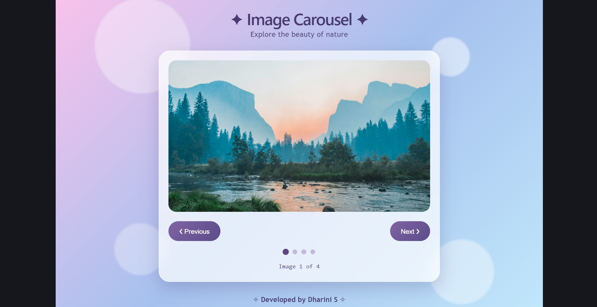
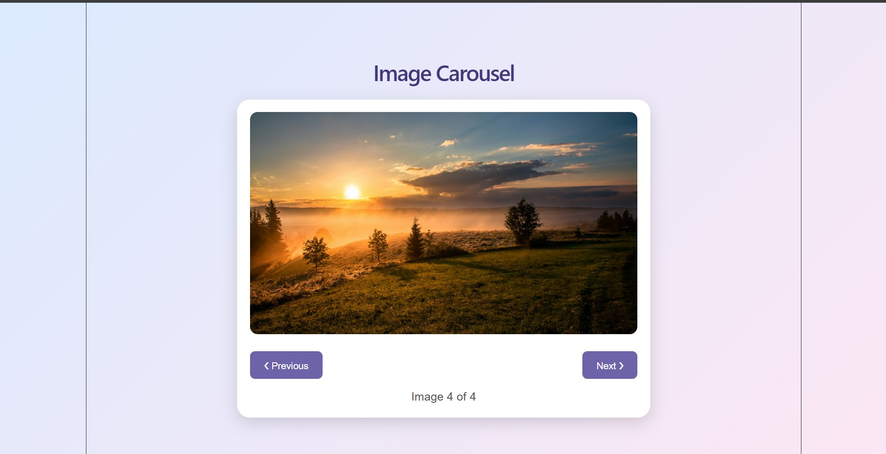

# Ex05 - Image Carousel

# Date: 21.11.2026

## Aim
To create an image carousel using React.

## Algorithm

### Step 1: Initial Setup
Input: A list of images to display in the carousel.

Output: A component displaying the images with navigation controls (e.g., next/previous buttons).

### Step 2: State Management
Use a state variable (currentIndex) to track the index of the current image displayed.

The carousel starts with the first image, so initialize currentIndex to 0.

### Step 3: Navigation Controls
Next Image: When the "Next" button is clicked, increment currentIndex.

If currentIndex is at the end of the image list (last image), loop back to the first image using modulo:
currentIndex = (currentIndex + 1) % images.length;

Previous Image: When the "Previous" button is clicked, decrement currentIndex.

If currentIndex is at the beginning (first image), loop back to the last image:
currentIndex = (currentIndex - 1 + images.length) % images.length;

### Step 4: Displaying the Image
The currentIndex determines which image is displayed.

Using the currentIndex, display the corresponding image from the images list.

### Step 5: Auto-Rotation
Set an interval to automatically change the image after a set amount of time (e.g., 3 seconds).

Use setInterval to call the nextImage() function at regular intervals.

Clean up the interval when the component unmounts using clearInterval to prevent memory leaks.

## PROGRAM

App.css
```
* {
  margin: 0;
  padding: 0;
  box-sizing: border-box;
}

body {
  font-family: Arial, sans-serif;
  background: linear-gradient(135deg, #dbeafe, #fce7f3);
}

.container {
  min-height: 100vh;
  display: flex;
  flex-direction: column;
  align-items: center;
  justify-content: center;
}

h1 {
  color: #433878;
  margin-bottom: 30px;
  font-size: 35px;
}

.carousel {
  background: white;
  padding: 20px;
  border-radius: 20px;
  box-shadow: 0 8px 25px rgba(0,0,0,0.15);
  text-align: center;
  width: 650px;
  max-width: 90%;
}

.carousel img {
  width: 100%;
  height: 350px;
  object-fit: cover;
  border-radius: 12px;
}

.controls {
  display: flex;
  justify-content: space-between;
  margin-top: 20px;
}

button {
  background: #6c63a8;
  color: white;
  border: none;
  padding: 12px 22px;
  border-radius: 8px;
  cursor: pointer;
  font-size: 15px;
}

button:hover {
  background: #433878;
}

p {
  margin-top: 15px;
  color: #555;
}
```

App.jsx

```jsx
import { useState, useEffect } from "react";
import "./App.css";

const images = [
  "https://images.unsplash.com/photo-1506744038136-46273834b3fb?w=1000",
  "https://images.unsplash.com/photo-1470770841072-f978cf4d019e?w=1000",
  "https://images.unsplash.com/photo-1500530855697-b586d89ba3ee?w=1000",
  "https://images.unsplash.com/photo-1470252649378-9c29740c9fa8?w=1000"
];

function App() {
  const [currentIndex, setCurrentIndex] = useState(0);

  const nextImage = () => {
    setCurrentIndex((prev) => (prev + 1) % images.length);
  };

  const previousImage = () => {
    setCurrentIndex((prev) =>
      (prev - 1 + images.length) % images.length
    );
  };

  useEffect(() => {
    const interval = setInterval(() => {
      setCurrentIndex((prev) => (prev + 1) % images.length);
    }, 3000);

    return () => clearInterval(interval);
  }, []);

  return (
    <div className="container">
      <h1>Image Carousel</h1>

      <div className="carousel">
        

        <div className="controls">
          <button onClick={previousImage}>❮ Previous</button>
          <button onClick={nextImage}>Next ❯</button>
        </div>

        <p>
          Image {currentIndex + 1} of {images.length}
        </p>
      </div>
    </div>
  );
}

export default App;
```

## Output





## Result
The React image carousel was created and executed successfully.